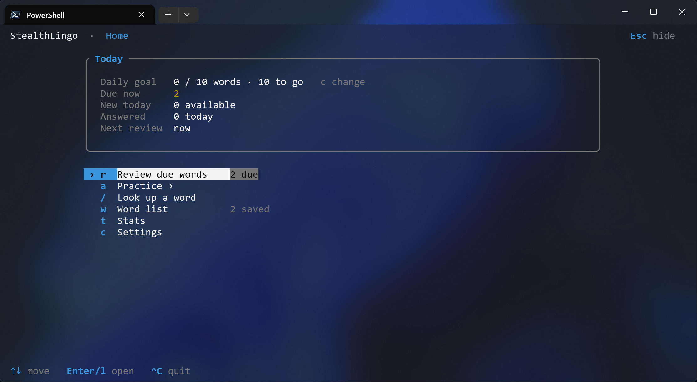

# StealthLingo

[English](../../README.md) | [简体中文](README.zh-CN.md) | [繁體中文](README.zh-TW.md) | [日本語](README.ja.md) | [한국어](README.ko.md) | [Español](README.es.md) | [Português (Brasil)](README.pt-BR.md) | [Русский](README.ru.md) | **Tiếng Việt**

[](https://github.com/viys/stealthlingo/releases) [](../../LICENSE)

Luyện vài từ tiếng Anh trong lúc đang trốn việc. Nhấn **Esc** thì terminal này mở một shell và gõ lệnh được; nhấn Esc lần nữa là quay lại. Esc không được gửi vào shell đó. Đồng hồ tạm dừng khi đang ẩn.

Khoảng trống đó là bất cứ thứ bạn vốn đã có — một lần build, cuộc họp bạn không thực sự ngồi, hay lúc chờ AI trả lời. Tra một từ, lưu lại, rồi luyện flashcard, chính tả hoặc nghe vài phút. Dữ liệu từ điển lấy từ [Wiktionary](https://en.wiktionary.org/) tiếng Anh (không cần API key). Tiến độ lưu trong SQLite cục bộ, nên từ đã lưu vẫn luyện được offline. Máy chủ MCP tùy chọn để agent thêm những từ nó nhận ra; bản thân StealthLingo không bao giờ gọi mô hình AI.



Hướng dẫn đầy đủ trong **[Wiki](https://github.com/viys/stealthlingo/wiki)** (phím, lệnh, chế độ, MCP, sao lưu, FAQ, phát triển). v0.1 chỉ hỗ trợ tiếng Anh.

## Vì sao StealthLingo

Một khoảng trống bạn rời đi ngay được: một buổi ngắn, Esc khi có người tới, và danh sách lớn dần từ những từ bạn thật sự gặp — trong tài liệu, code hay chat.

| Có | Không có |
|---|---|
| TUI toàn màn hình hoặc prompt `--plain` | Tài khoản, đồng bộ đám mây hay GUI |
| Esc ẩn màn hình và mở shell; Esc để quay lại. Đồng hồ tạm dừng khi đang ẩn | Phải thoát app mới giấu được màn hình |
| Flashcard, chính tả, chữ thiếu, nghe, hỗn hợp, luyện lại lỗi | Định nghĩa do AI viết |
| Mục tiêu từ mỗi ngày + lặp cách quãng (SM-2 rút gọn) | Khóa học dài bắt buộc |
| Âm thanh UK / US khi Wiktionary có | Mạng bắt buộc để ôn |

## Cài đặt

Binary sẵn cho Windows, macOS và Linux — không cần Rust:

```powershell
# Windows (PowerShell)
powershell -ExecutionPolicy Bypass -c "irm https://github.com/viys/stealthlingo/releases/latest/download/stealthlingo-installer.ps1 | iex"
```

```bash
# macOS / Linux
curl --proto '=https' --tlsv1.2 -LsSf https://github.com/viys/stealthlingo/releases/latest/download/stealthlingo-installer.sh | sh
```

Hoặc từ mã nguồn (Rust 1.88+; Linux cần `libasound2-dev` để build):

```bash
cargo install --git https://github.com/viys/stealthlingo
```

## Bắt đầu nhanh

```bash
stealthlingo                           # app toàn màn hình; Esc để ẩn
stealthlingo study --minutes 3         # một buổi vừa khít khoảng trống
stealthlingo lookup ephemeral          # phát âm + định nghĩa chính (--all để xem hết)
stealthlingo add ephemeral --note "lasting a short time"
stealthlingo --plain                   # prompt từng dòng
```

Trang chủ: `r` ôn · `a` luyện · `/` tra từ · `w` danh sách · `t` thống kê · `c` cài đặt · **Esc** ẩn · **Ctrl+C** thoát (`q` chỉ quay lại).

Chế độ luyện (`a`, hoặc bấm thẳng chữ cái): `s` flashcard · `p` chính tả · `m` chữ thiếu · `i` nghe · `x` hỗn hợp · `e` luyện lại lỗi.

## Lệnh

| Lệnh | Việc làm |
|---|---|
| `stealthlingo` | Mở app toàn màn hình |
| `lookup <WORD> [--all]` | Tra Wiktionary (offline dùng cache) |
| `add` / `remove` | Lưu hoặc xóa từ |
| `words` / `search` | Liệt kê hoặc tìm (`--status`, `--pos`, `--due`) |
| `study` / `review` | Luyện (`--mode`, `--mistakes`, `--minutes`, `--count`) |
| `stats` | Tiến độ và độ chính xác |
| `audio <WORD>` | Phát âm |
| `config` | Xem hoặc đổi cấu hình |
| `export` / `import` | Sao lưu `.json` hoặc danh sách `.csv` |
| `mcp` | Máy chủ MCP cho AI agent |
| `links` | Tra từ bấm được (Windows) |

```bash
stealthlingo study --mode spelling --count 10
stealthlingo study --mode listening --minutes 5
stealthlingo study --mistakes
stealthlingo review
```

## AI agent (MCP)

Lúc bạn đang làm việc thật, agent có thể lưu từ cho lần trốn việc sau. Trỏ client tới StealthLingo (ví dụ Cursor `~/.cursor/mcp.json`):

```json
{
  "mcpServers": {
    "stealthlingo": {
      "command": "stealthlingo",
      "args": ["mcp"]
    }
  }
}
```

Agent có thể tra từ và thêm vào danh sách. Không thể xóa từ, đổi cài đặt hay ghi câu trả lời. Chi tiết: [Wiki · AI Agents](https://github.com/viys/stealthlingo/wiki/AI-Agents-MCP).

## Dữ liệu & sao lưu

Thư mục dữ liệu mặc định: `%APPDATA%\stealthlingo\data` (Windows), `~/Library/Application Support/stealthlingo` (macOS), `~/.local/share/stealthlingo` (Linux). Ghi đè bằng `STEALTHLINGO_HOME`.

```bash
stealthlingo export backup.json    # sao lưu đầy đủ
stealthlingo import backup.json    # gộp (tiến độ mới hơn thắng)
```

## Đóng góp

Hoan nghênh issue và pull request. Cách build và chạy test: [Wiki · Development](https://github.com/viys/stealthlingo/wiki/Development).

## Giấy phép

MIT — xem [LICENSE](../../LICENSE).
